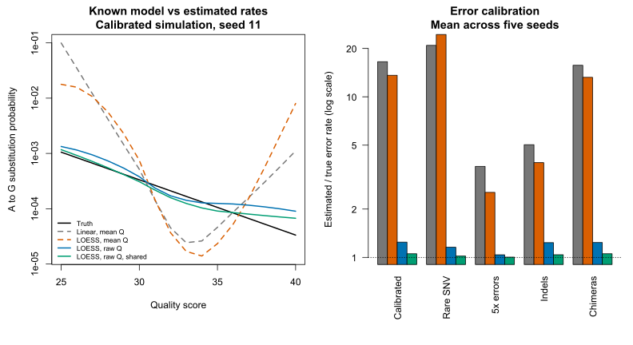

# Error learning — DADA2.jl 0.3.0

0.3.0 improves the estimation of substitution probabilities, distinguishes
convergence from data support, and makes it possible to learn a model shared
across samples while keeping the original FASTQ qualities.

## Method

The new smoothing uses quadratic local regression on the logarithms of the
rates, weights proportional to the exposures of the source base and a tricube
kernel. It takes the degree 2 and span 0.75 of the LOESS method used by
DADA2 R. The +1 pseudocount per transition is kept, with probabilities between
1e-7 and 0.25 and diagonals obtained by difference. Outside the range of
observed qualities the boundary value is held. For one, two or three observed
values, linear interpolation of the log rates is used, constant in the
single-value case; a source base without observations keeps the initial model.

The Julia implementation computes LOESS directly. By default DADA2 R uses an
interpolated surface: agreement is not necessarily exact.
The independent test on synthetic transitions compares Julia with R in direct
mode, with tolerances `rtol=1e-10`, `atol=1e-13`.
Sources: [R's loess](https://stat.ethz.ch/R-manual/R-devel/library/stats/html/loess.html)
and [upstream loessErrfun](https://github.com/benjjneb/dada2/blob/b61fe2e90115be08e78a01a16af89fd21402ca42/R/errorModels.R).

A second change concerns the counts: with FASTQ paths, `learnErrors` now uses
the original qualities by default (`qualityMode=:raw`). After each inference
it rereads the selected prefixes and counts substitutions against the assigned
ASVs. Rejected reads and inserted bases without an aligned position do not
contribute. No quality × position histogram is stored for each sequence: the
added cost is one FASTQ pass per iteration plus the alignment maps of the
unique sequences. Gzip files are also read in streaming mode.
The recount uses a private matrix per sample, is parallelised over samples and
ends with a reduction in stable order.

`Derep` objects store only mean qualities, so `learnErrors(derep)` keeps using
them. The same behaviour can be requested for FASTQ files with
`qualityMode=:mean`. Raw mode changes the statistical model compared with
counting the means; ASV inference still uses the mean qualities of the
dereplicated sequences. The change does not make every part of the pipeline
equivalent to R.

## Usage and diagnostics

```julia
learned = learnErrors(["sample1.filtered.fastq.gz", "sample2.filtered.fastq.gz"])
diagnostics = errorDiagnostics(learned)
@show learned.converged learned.inference_converged learned.quality_mode
@show learned.training_reads learned.training_bases
@show diagnostics.unobserved_sources
```

The default `nbases=100_000_000` limits training without loading the reads
into memory. The remaining budget is divided among the files still to be read,
so every non-empty sample receives a deterministic share as long as the budget
allows. Whole reads are always kept, so the total may exceed `nbases` by at
most the length of the selected reads. `nbases=typemax(Int)` uses all the
data. The same budget applies with `qualityMode=:mean`, making the two modes
comparable.

Inference is run separately on each sample and the transitions are aggregated
to estimate a single model. Use samples with the same sequencing technology
and process: aggregating heterogeneous data can hide real differences in error
rates.

During learning `omegaC=0` is the default: all assigned reads contribute to
the counts, as in the upstream procedure. The value can be changed explicitly
without altering the default of `dada`.

`learned.transitions` holds the counts from the last update.
`errorDiagnostics` returns exposures, observed and expected substitutions,
and a support mask, with four rows A/C/G/T and columns starting at Q0.
It also reports `training_reads` and `training_bases`, measured before reads
or positions not assigned by inference are excluded.
`supported` means at least one observation, not sufficient precision.
These are diagnostics of the training data, not an independent validation.
`converged=true` indicates stability of the model and of inference; it does not
guarantee biological accuracy.

For comparisons with the previous version, `smoother=:linear` is available.
To reproduce the old learning from files, use both options:
`learnErrors(path; smoother=:linear, qualityMode=:mean)`.

## Comparison with known ground truth

The 30 cases from the 0.2.0 validation were reused, five seeds for each of the
six conditions. The seven compared modes produce **210 measurements**: linear
and LOESS on means, raw LOESS, the corresponding three Julia models shared
across the five samples, and R with learned errors.
The shared models learn from the same five samples on which they are
measured: this is not an evaluation on samples held out from learning.

Inference parameters, pseudocounts and thresholds were not tuned to increase
ASV recovery. The new smoothing derives from the R method; raw counts correct
the loss of the quality distribution. These data were used to develop the
change and are not an independent confirmation dataset.

Calibration compares the estimated model with the generator probabilities,
on Q25–40, assigned uniformly. The total rate weights the source bases by the
abundances and the true biological sequences. The L1 error sums the absolute
differences of the substitutions with the same weights; log10 RMSE compares the
twelve off-diagonal curves, with uniform weights.
These metrics target the qualities of individual reads: curves estimated on
mean qualities have a different operational interpretation, so the comparison
does not demonstrate a general inferiority of R.

Mean ratio between estimated and true rate, where **1** indicates calibration
of the aggregate rate; it does not measure the agreement of every individual
transition:

| Condition | Linear, means | LOESS, means | Raw LOESS | Shared raw LOESS |
| --- | ---: | ---: | ---: | ---: |
| Calibrated | 16.55 | 13.62 | 1.245 | 1.053 |
| Rare SNVs | 20.90 | 24.43 | 1.157 | 1.019 |
| Errors ×5 | 3.69 | 2.54 | 1.038 | 1.004 |
| Indels | 5.03 | 3.89 | 1.235 | 1.039 |
| Chimeras | 15.71 | 13.22 | 1.238 | 1.053 |

In the calibrated condition, log10 RMSE goes from 0.971 for the linear method
to 0.321 for raw LOESS, and 0.142 with the shared raw model. The individual
curves remain imperfect, particularly for rare transitions.
Five seeds are not enough to claim statistical equivalence.



All Julia modes keep 100% ASV precision on these cases.
Recovery of biological ASVs with at least two reads remains **80%** in the
cases with errors and **75%** for rare SNVs. In the error-free condition, raw
LOESS recovers 80%, against 84% for the old method and 88% for LOESS on means:
better calibration does not automatically mean more ASVs.
The pseudocount produces positive rates even when the truth is zero:
0.000301 for raw on a single sample and 0.0000797 for shared raw.

On the experimental mock, using the same filtered files as R, all three Julia
modes produce **20 ASVs, 20 exact matches, zero without a match and
4,269 final reads**. The true error model of the mock is unknown, so this check
verifies the biological result, not the calibration.
In the indel scenario, the known model describes substitutions only.

## Results and reproduction

- [Individual measurements](../validation/error_learning_results.tsv)
- [Means per condition](../validation/error_learning_summary.tsv)
- [Experimental mock](../validation/error_learning_mock.tsv)
- [Versions, code and input hashes](../validation/error_learning_metadata.json)

With the data and R results already prepared by the scientific validation:

```powershell
julia --project=. --threads=4 -e 'using Pkg; Pkg.test()'
julia --project=. --threads=4 validation/error_learning_evaluate.jl
julia --project=. --threads=4 validation/error_learning_mock.jl
& 'C:\Program Files\R\R-4.5.0\bin\Rscript.exe' validation/error_learning_summary.R
powershell -NoProfile -ExecutionPolicy Bypass -File scripts/error-learning-metadata.ps1
```

The LOESS fixtures are regenerated with `validation/error_smoothing_fixture.jl`
and `validation/error_smoothing_reference.R`. Local environment: Julia 1.12.2,
four threads, R 4.5.0, DADA2 R 1.36.0, Windows, 10 October 2026.
The full suite passes **683 assertions**, 54 of which cover the new estimation;
the six checks on the mock verify matches and convergence of the three modes.
The 0.2.0 scientific results remain in that version's historical report.
