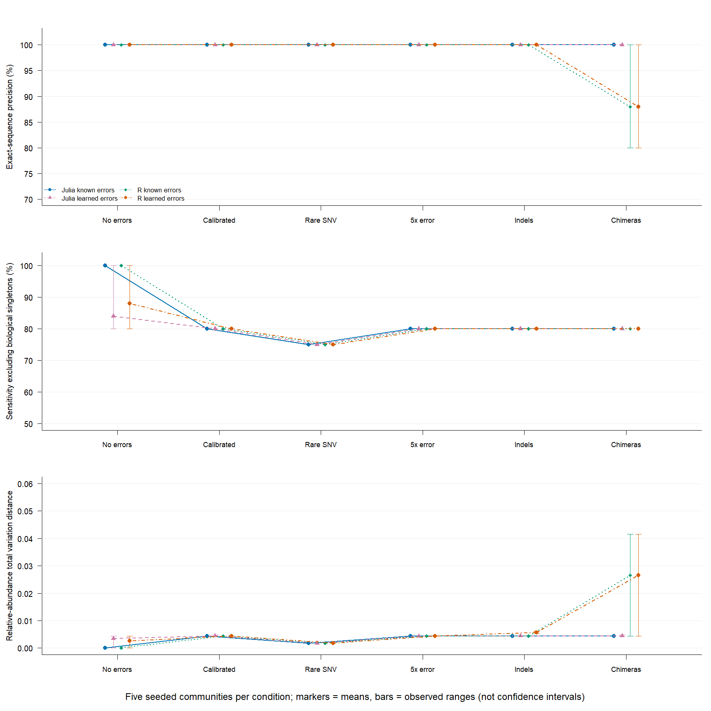

# Preliminary scientific validation — DADA2.jl 0.2.0

This report preserves the 0.2.0 results. The filter fix and the subsequent
comparison in 0.2.1 are described in [release-0.2.1.md](release-0.2.1.md).

Experiments run on 10 October 2026 on Windows with Julia 1.12.2, four threads,
R 4.5.0 and DADA2 R 1.36.0. The denoiser code was unchanged during the
experiments: only scripts and reports were added.
The identity of the seven source files with the 0.2.0 archive is verified via
SHA-256 in [source_integrity.tsv](../validation/source_integrity.tsv).

**Conclusion:** promising results on an experimental mock community, but
insufficient sensitivity for some rare variants and differences from R.
The package is not yet validated as a general replacement for DADA2 R.

## Real mock community

Sample Mock_S280 from the mothur MiSeq SOP dataset is a known community, also
used in the [DADA2 tutorial](https://benjjneb.github.io/dada2/tutorial.html).
The tutorial reports 20 strains present and one nominal strain absent.
Our comparison uses the HMP_MOCK.v35.fasta references included in the dataset,
without assuming that every record represents a distinct ASV.

| Pipeline | Final ASVs | Exact matches to the reference | ASVs without a match | Final reads |
| --- | ---: | ---: | ---: | ---: |
| Julia, own learning | 20 | 20 | 0 | 4,276 |
| Julia, R filters and model | 20 | 20 | 0 | 4,269 |
| DADA2 R, own learning | 20 | 20 | 0 | 4,269 |

The 20 ASVs correspond to exact fragments of the expected sequences. Each
pipeline covers 27 of the 32 reference records: the records are not all
distinct amplicons, so this number is not a measure of strain sensitivity.
The true abundances of the individual amplicons are unknown.

The Julia filter keeps 4,323 of the 4,779 pairs, against 4,314 for R.
The audit verifies that all 4,314 common pairs have identical sequences and
qualities. The nine extra Julia pairs have one mate shorter than the required
length after quality truncation. The 0.2.0 filter applies `truncLen` before
`truncQ` without discarding a read that becomes shorter than the target; this
is a compatibility difference to be fixed in a later version. The independent
final counts differ by seven reads; we do not attribute the whole difference to
the filter, because the errors change as well.

Identity with R of the pipeline with shared filters/errors is confirmed for
this sample. Zero ASVs without a match does not demonstrate a universal error
rate of zero, nor taxonomic accuracy on other databases.

## Simulations with known ground truth

Five communities generated with independent seeds, each subjected to six
conditions: 30 cases, analysed with five combinations of implementation and
model, for **150 measurements**. There are five independent replicates per
condition; the same seeds are reused across conditions.
None of the 60 R runs failed; all 30 Julia error estimates reached the
convergence criterion. The full protocol, including the limitations of the
simulator, is in [scientific-protocol.md](scientific-protocol.md).

The following metrics are means over the five replicates. "Sensitivity ≥2"
excludes biological singleton ASVs, because singleton detection is disabled.
Precision uses exact sequence identity; TV measures the distance between
relative abundances and ranges from 0 (identity) to 1.

| Condition | Julia precision, learned errors | Julia sensitivity ≥2 | R sensitivity ≥2 | Julia TV |
| --- | ---: | ---: | ---: | ---: |
| No sequencing errors | 100% | 84% | 88% | 0.00346 |
| Calibrated errors | 100% | 80% | 80% | 0.00442 |
| Rare SNVs | 100% | 75% | 75% | 0.00177 |
| Miscalibrated qualities, errors ×5 | 100% | 80% | 80% | 0.00433 |
| Indels | 100% | 80% | 80% | 0.00442 |
| Chimeras | 100% | 80% | 80% | 0.00442 |

In the calibrated/miscalibrated/chimera scenarios the 20-read SNV variant is
not recovered. In the rare scenario the 10-read and 1-read SNVs are lost:
full sensitivity is 60%, and 75% excluding the singleton.
In the indel scenario the true insertion variant is not recovered.
These losses also occur with the known transition model and also in R:
abundance alone does not make a variant separable from noise with the default
thresholds, and the model used does not explicitly describe indel
probabilities.

Without errors and with the true model, both implementations recover all five
ASVs with exact counts. Learning the errors from a small error-free sample
instead introduces regularisation/pseudocounts: Julia loses the rarest variant
in four replicates out of five, R in three out of five.
This highlights a limitation of learning, even when the numerical convergence
criterion is satisfied.

Julia TV stays below 0.00477 across the 30 cases. Low aggregate bias does not
compensate for the loss of rare variants: abundant sequences dominate this
metric. Statistical significance or equivalence was not computed on only five
replicates per condition.

In the chimera case R keeps the artificial chimera in three replicates out of
five, with a mean precision of 88%; Julia removes it in all five. The chimera
checks use different algorithms, and the simulator generates exact
recombinations of sequences of the same length. This limited result does not
demonstrate a general superiority of Julia on real chimeras or chimeras with
indels.

Reusing the errors learned by R, the final Julia table matches R exactly in 22
of the 30 cases. The eight differences concern indels and chimeras. The match
on the initial fixture alone therefore does not generalise to all these
scenarios.



The vertical segments show the observed range of the five replicates,
**not confidence intervals**. Exportable vector version:
[scientific-validation.svg](figures/scientific-validation.svg).

## Reproducibility

Individual results: [scientific_results.tsv](../validation/scientific_results.tsv).
Means/ranges: [scientific_summary.tsv](../validation/scientific_summary.tsv).
Real mock: [mock_results.tsv](../validation/mock_results.tsv).
Filter audit: [mock_filter_audit.tsv](../validation/mock_filter_audit.tsv).
Versions and checksums of sources and inputs:
[scientific_metadata.json](../validation/scientific_metadata.json).

DADA2 must be installed in R; the plots use only standard R graphics. From this
directory on Windows:

```powershell
powershell -NoProfile -ExecutionPolicy Bypass -File scripts/scientific.ps1 `
  -RscriptPath 'C:\Program Files\R\R-4.5.0\bin\Rscript.exe'
```

On Linux/macOS with PowerShell and Rscript on the PATH:
`pwsh -File scripts/scientific.ps1`.
The script downloads about 37 MB, verifies the checksum, generates the data,
runs both implementations and produces metrics and plots. `-SkipDownload`
reuses the archive already present, still verifying its hash.
The download and the generated FASTQ files stay in `validation/generated`,
excluded from the distribution archives; scripts, results and plots are
included. To reproduce the random data exactly, use the same Julia version.

SHA-256 of the public dataset:
`728f7544824f8ca0223618b18bb60fce6a5dc20ae3d476267dbd5cf5594a35d4`.

## What remains to be validated

Further independent experimental mocks and negative controls; sensitivity
curves by depth and genetic distance; correlated errors/PCR/index hopping;
indels and chimeras with different lengths; other regions/instruments;
taxonomic accuracy; error estimates over multiple samples and stability on
large studies. The observed limitations should be fixed on a development set
and then re-evaluated on new samples held out from development.
